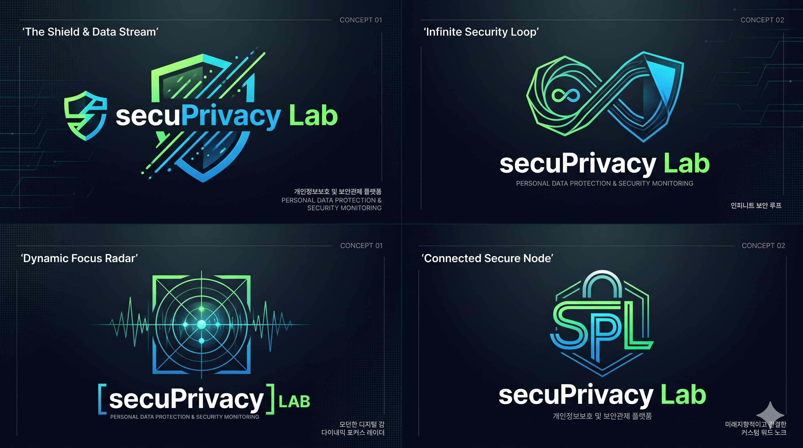

  
    
  <strong>보안 위협을 탐지하고, 컴플라이언스를 자동화하며, 안전한 소프트웨어를 설계합니다.</strong> 
  보안 관제·개인정보보호 SaaS부터 AI 에이전트 워크플로우까지 실전 솔루션을 구축합니다.
    
  <a href="#대표-프로젝트">주요 프로젝트</a> ·
  <a href="#집중하는-영역">핵심 역량</a> ·
  <a href="https://github.com/kjh9171?tab=repositories">All Repositories</a>

 

### 집중하는 영역

| Security Operations | Privacy & Compliance | Applied AI & Agents |
| :--- | :--- | :--- |
| 실시간 로그 수집 및 위협 탐지 파이프라인 | 개인정보 생명주기 및 동의·파기 자동화 | 로컬 LLM 기반 에이전트 코딩 워크플로우 |
| 웹훅 기반 SIEM·엔드포인트 인시던트 대응 | ISMS-P·ISO27001 규제 대응 아키텍처 | 보안 로그 분석 및 스키마 검증 자동화 |

 

### 대표 프로젝트

<table>
  <tr>
    <td width="50%" valign="top">
      <h3><a href="https://github.com/kjh9171">01 / secuLab (시큐랩)</a></h3>
      <strong>단일 화면 기반 실시간 보안관제 모니터링 SaaS</strong>  
      SIEM, 보안장비, 웹서버, 엔드포인트 PC의 웹훅 로그 수집부터 AI 기반 위협 분석 및 인시던트 대응까지 엔드투엔드 워크플로우를 제공합니다.
    </td>
    <td width="50%" valign="top">
      <h3><a href="https://github.com/kjh9171">02 / secuprivacy (시큐프라이버시)</a></h3>
      <strong>개인정보보호 관리체계 자동화 솔루션</strong>  
      기업의 개인정보 처리 현황 파악, 법적 의무사항 점검, 수탁사 관리 및 컴플라이언스 증적 관리를 단일 플랫폼으로 통합합니다.
    </td>
  </tr>
</table>
